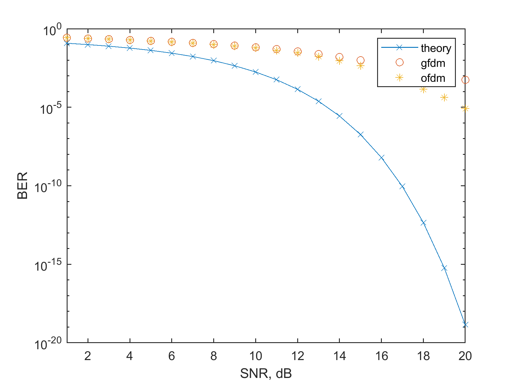
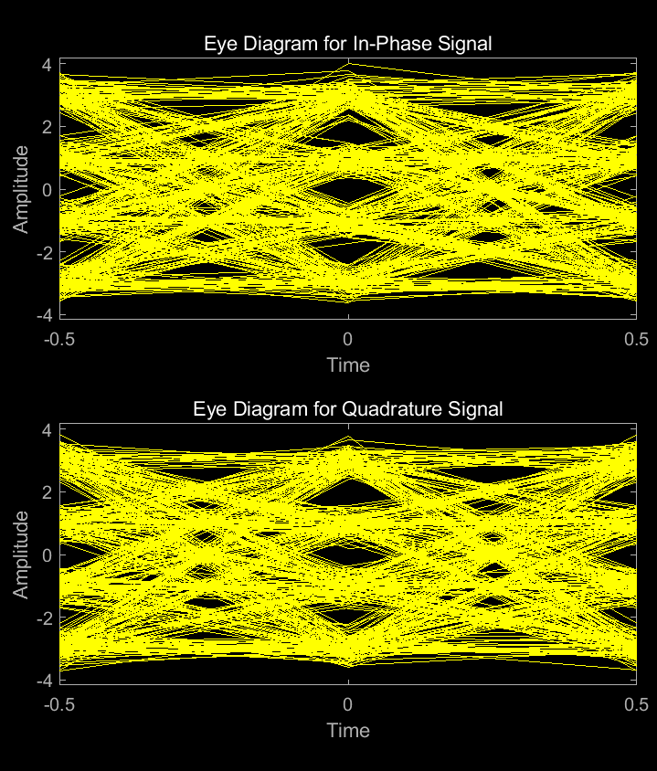
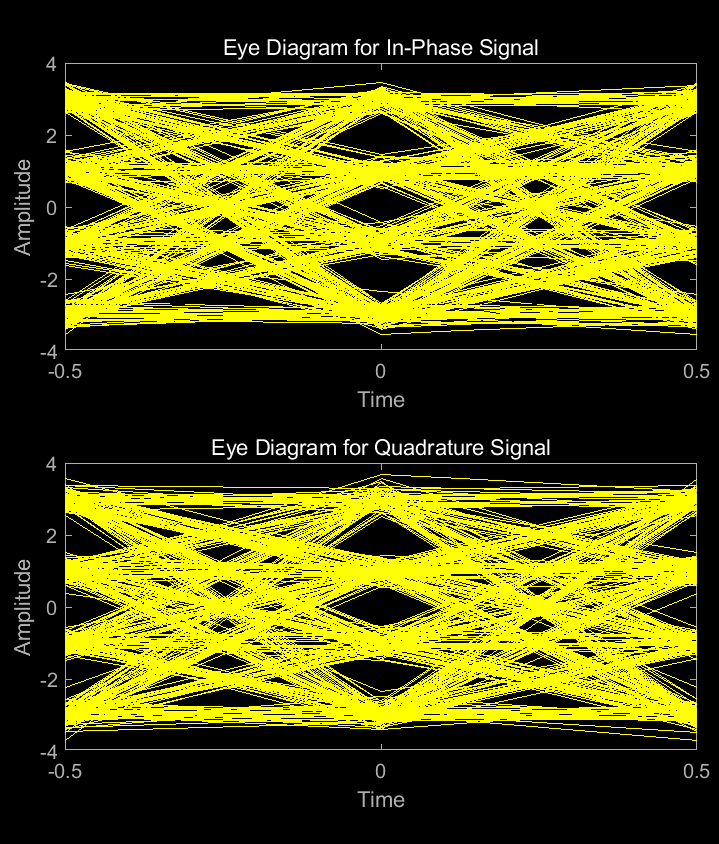
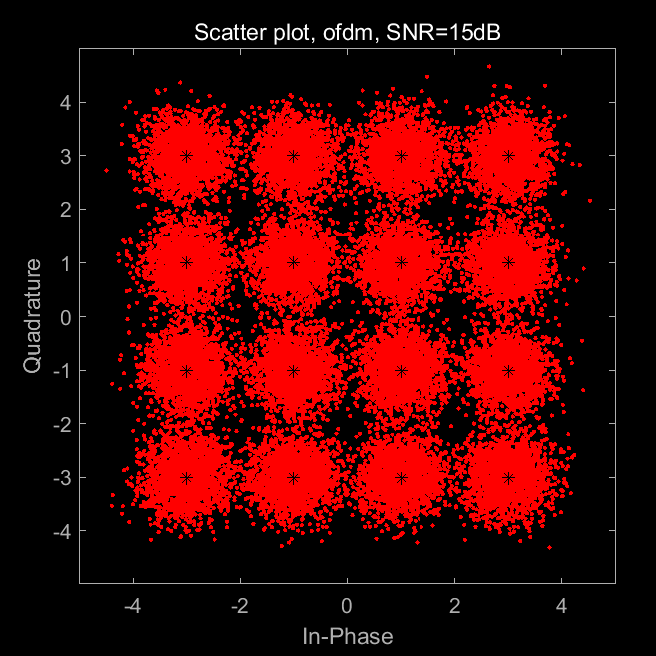
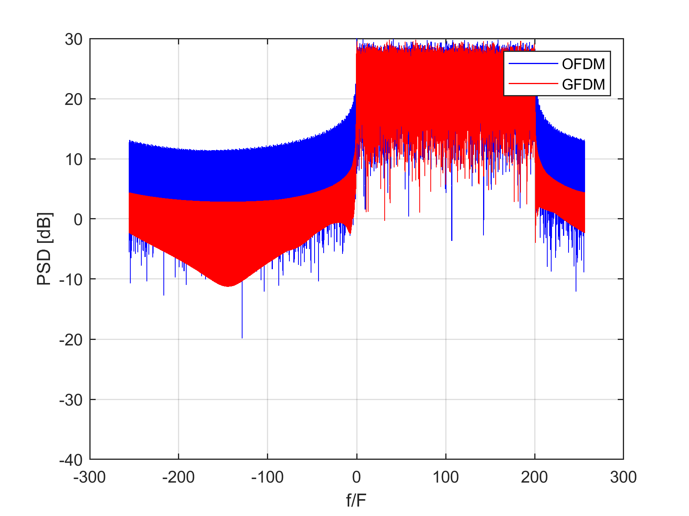
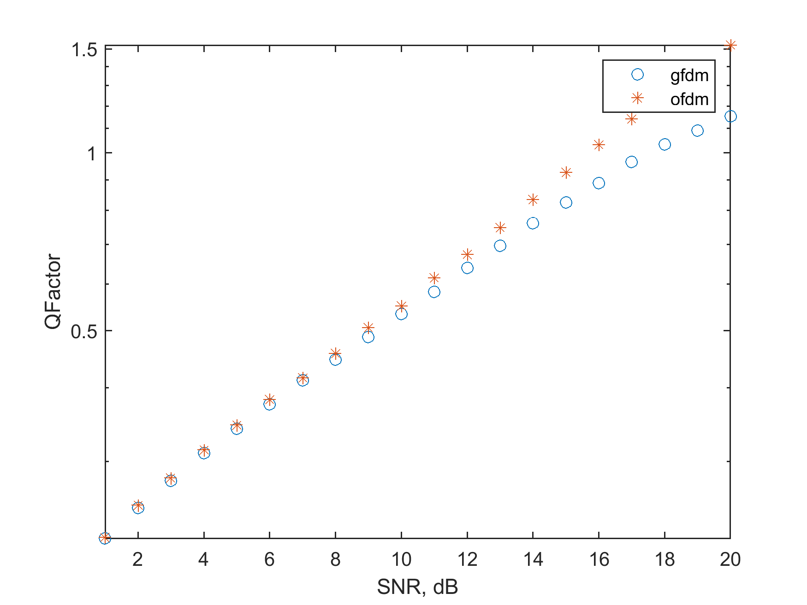
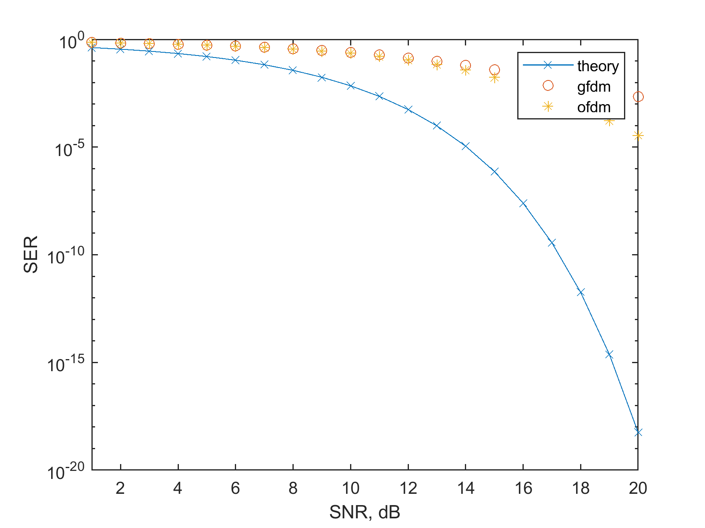

# Comparative Analysis of Generalized Frequency Division Multiplexing (GFDM) and Orthogonal Frequency Division Multiplexing (OFDM) in Radar Communications with Integrated 5GNR [Attached MATLAB Code]

This program implements OFDM and GFDM transmission/reception simulations, and uses MATLAB R2020 b environment for encoding and testing. The program allows users to change the simulated results by editing the parameters of "ofdm" and "gfdm", with default values set up in advance. The simulation randomly encodes symbols into OFDM and GFDM signals, sends them through an AWGN channel affected by different SNR levels, and then decodes the received signals to obtain corresponding spectrum diagrams, eye diagrams, constellation diagrams, BER, SER, Q factor.
\n        \n  
\n        \n  
\n        \n  
\n        \n  
\n        \n  
\n        \n  
\n        \n  

## Images

<!-- PAYMENT_BLOCK -->

## Get this dataset

- Payment link (Stripe): [Buy now](https://buy.stripe.com/3cs8yP7sY87d0vu9AB)
- Payment QR code: 

<!-- /PAYMENT_BLOCK -->
